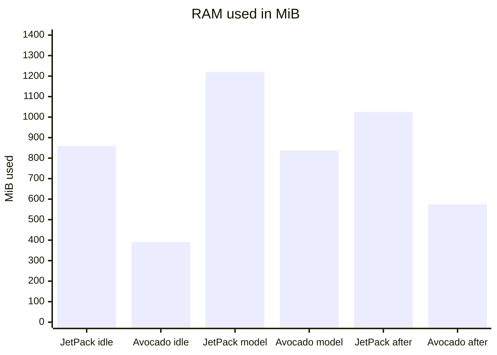

import PullQuote from '@site/src/components/PullQuote'
import TestStatus from '@site/src/components/TestStatus'

<TestStatus
  targets={['jetson-orin-nano-devkit']}
  cli="1.1.0-dev"
  reference={{
    label: 'jetson-orin-nano-power',
    href: 'https://github.com/avocado-linux/references/tree/main/jetson-orin-nano-power',
  }}
/>

**TL;DR.** The same Jetson Orin Nano 8GB, two OS images, one ResNet-50 FP16 TensorRT engine. Every figure is one install and one run.

**Ubuntu + JetPack 7.2.1** (stock desktop)

- RAM used: 857 to 861 MiB at idle, 1220 MiB while the model runs (6265 MiB left at the low point)
- Disk: `nvidia-jetpack` adds about 26 GB on top of the stock install [ENGINEER: record the total used disk with `df` on the JetPack install, so the line can state one figure in GB]
- Setup: about 30 minutes, 12 manual steps

**Avocado OS**

- RAM used: 390 to 391 MiB at idle, 837 MiB while the model runs (6626 MiB left at the low point)
- Disk: a 70.8 MB root filesystem image, and a 3.2 GB `/var` image once the TensorRT libraries are in it (0.58 GB without them)
- Setup: 6 minutes 56 seconds, 4 commands

{/* truncate */}

## What this is

Avocado OS is a Yocto-based embedded Linux distribution that ships as an immutable root filesystem plus extensions layered on top of it. Peridio builds the device fleet platform around it. The Jetson Orin Nano 8GB has 8 GB of RAM shared between the CPU and the GPU, so whatever the operating system holds is memory a model cannot use. Add TensorRT on top of JetPack and a large part of the 8 GB can be gone before your application starts.

This note puts the same board through two OS images and measures what is left for the workload: first at idle, then with a TensorRT model loaded.

## How I measured it

The board is a Jetson Orin Nano 8GB devkit. The two images:

- **JetPack 7.2.1** as a typical user runs it: NVIDIA's `jetsoninstaller-r39.2.1-2026-08-07-18-30-47-arm64.iso` (5,035,601,920 bytes), installed to the NVMe, giving Ubuntu 24.04 with the GNOME desktop on kernel 6.8.12-1021-tegra, default services, no trimming. The stock install has no CUDA, TensorRT or `trtexec`; `apt-get install nvidia-jetpack` adds them (TensorRT 10.16.2.10) and about 26 GB of disk.
- **Avocado OS** from the `jetson-orin-nano-power` reference: the `avocado-bsp-jetson-orin-nano`, `avocado-ext-dev`, `avocado-ext-sshd-dev` and `avocado-ext-bringup` extensions on linux-yocto 6.18.52.

Both sides run TensorRT natively, with `trtexec` from `/usr/src/tensorrt/bin`, not in a container. No camera is involved: `trtexec` feeds the engine its own inputs, so the numbers measure the engine and the memory around it, not a camera pipeline. [ENGINEER: embed the two install recordings here once they are on YouTube, as the screenshot of it working]

Memory is read on the device after the boot has settled, with one command on both sides:

```bash
free -m | awk 'NR==2{print $3 " MiB used, " $7 " MiB available"}'
```

For the loaded case, the same ONNX model is built into a TensorRT engine and run on each OS, and memory is read while it runs. On JetPack the model is `resnet50-v1-12.onnx` from the ONNX model zoo (102,576,593 bytes), built with `trtexec --onnx=... --fp16` and run for 60 seconds, with `MemAvailable` sampled every 2 seconds in the 25 W mode. The protocol is a cold boot, 4 minutes to settle, three idle readings 5 seconds apart, the 60-second run, then three idle readings again. On Avocado OS the same model was fetched on the board (sha256 checked), built with the same flags (`/usr/src/tensorrt/bin/trtexec --onnx=... --saveEngine=... --fp16`, 46.8 s, a 51,525,476-byte engine) and run with `--loadEngine=... --duration=60 --warmUp=1000`, after a warm reboot and 240 seconds of uptime, with `MemAvailable` sampled every 2 seconds (32 samples).

## Ubuntu + JetPack 7.2.1

### Getting started

JetPack comes as a 5.0 GB ISO with a lot of software in it, and the install is manual: a person writes the card, boots the installer from the UEFI menu, picks the target and then works through the first-boot setup. The result is a general-purpose Ubuntu image carrying the usual desktop and server services that an embedded product then has to strip back out. I counted 12 manual steps: writing the ISO, two selections in the GRUB menus, seven first-boot dialogs (license, language, location, keyboard, network configuration, time zone and user account), enabling `sshd`, and installing `nvidia-jetpack`.

Problems that cost time on an embedded device:

- On four runs on the same board on 2026-11-06, the stock installer stopped at Step 9 of 13 with `An error occurred. Press enter to start a shell`. The interface `enP8p1s0` was never brought up in the runs I inspected, and I got a DHCP lease by hand with `ip link set enP8p1s0 up` and `dhcpcd`. I did not isolate the cause.
- The install target decides how much the installer asks. `Install on NVMe` runs an unattended install from a fixed configuration, with no prompts for keyboard, user, storage layout or network, so there is no point at which to fix a network problem before it fails. The other targets open the interactive installer for those choices.
- `Install on microSD` did not work on this bench on 2026-11-09. The installer stopped with `preseed: force-bootdisk=mmcblk0 is not a valid storage device. Starting interactive installer.`, because `lsblk` listed no `mmcblk0`. The card sat behind an SDWire3 SD-card mux, which UEFI listed as `UEFI SanDisk SN64G SD Device`. I did not isolate whether the mux or the installer kernel hides it. The install ended up on the NVMe, which erased the Avocado OS image that was there.
- The stock image's `sshd` has no host keys, and I enabled it by hand to reach the board.
- 365 package updates were pending after the install.
- At idle the top resident processes were `gnome-shell` (226 MB), `nvargus-daemon` (135 MB), `mutter-x11-frames` (122 MB), `Xorg` (84 MB) and `dockerd` (79 MB).

### Timing

The times were not taken on one clean pass, so treat them as approximate:

- **ISO download:** not timed, because it depends on the bandwidth of whoever runs it.
- **Writing the ISO to the card:** 79.7 seconds with `dd` at 63.2 MB/s, then a byte-for-byte compare against the ISO.
- **Installer, from picking `Install on NVMe` to its Step 9 of 13:** 12 minutes 37 seconds (12:56:27 to 13:09:04). Step 5 of 13, `Installing required packages`, alone took 9 minutes 32 seconds.
- **The rest of the install and the manual steps:** about 15 minutes, from my own hand timing on an earlier install of the same ISO. I did not log it.
- **Total:** about 30 minutes from a written card to a configured board.

### Takeaways

- **Numbers:** about 30 minutes to a configured board, 857 to 861 MiB of RAM used at idle, a 1220 MiB peak while the model runs, and 6265 MiB left at the low point.
- **Experience:** 12 manual steps on every board, a stock installer that stopped part-way on four runs in a row, and an unattended install only when the target is the NVMe.
- **Production readiness:** a general-purpose Ubuntu desktop with `dockerd` running, 365 pending updates and no SSH host keys until someone enables `sshd`. A hundred boards means a hundred manual installs, which does not scale.
- **Against Avocado OS:** about 4.3 times as long to set up, about 2.2 times the RAM used at idle, about 46% more used at the peak of the model run, and 447 MiB less available at idle.

## Avocado OS

### Getting started

Avocado OS is installed from the project with four commands, recorded in one pass from a clean project directory on 2026-11-06 (host time, from the recording's marks):

- **`avocado install -f`:** 69 seconds in a project directory with no earlier install state, with the SDK image already on the host.
- **`avocado build`:** 7 seconds.
- **`avocado provision -r power --profile tegraflash-nvme`:** 4 minutes 49 seconds, including the var image build and the flash. It asked for no confirmation.
- **Boot:** the board booted into the flashed image by itself, 38 seconds from the end of the flash (21:30:56) to the automatic root login on the serial console (21:31:34). There was no power cycle and no step at the board.

All four extensions were merged on first boot (`Total: 4 extension(s), 4 merged`), on Avocado OS 2026.73 with kernel 6.18.52. The same image takes OTA updates and is managed as a fleet through Peridio, so the board is provisioned once and updated in place afterwards.

### Timing

- **Total:** 6 minutes 56 seconds from the first `avocado install` to the login. Putting the board into recovery mode beforehand is not counted.
- **SDK image download:** not counted, because it depends on bandwidth. The SDK image is 140 MB, and the project's SDK volume grew to about 5.5 GB after the install.

### Takeaways

- **Numbers:** 6 minutes 56 seconds to a logged-in board, 390 to 391 MiB of RAM used at idle, an 837 MiB peak while the model runs, and 6626 MiB left at the low point.
- **Experience:** four commands, no step at the board, and the board boots into the new image by itself.
- **Production readiness:** an immutable root filesystem with extensions on top, OTA updates, and fleet management through Peridio. The reference carries three development extensions, a root serial console and root SSH among them, to remove before shipping.
- **Against JetPack:** about 77% less setup time, about 55% less RAM used at idle, about 31% less at the peak of the model run, and 447 MiB (about 7%) more RAM available at idle.

<PullQuote label="Setup">
  About **30 minutes** of installer and manual steps for stock JetPack (approximate), against **6
  minutes 56 seconds** for Avocado OS from the first command to a logged-in board.
</PullQuote>

## Result

<PullQuote>
  Avocado OS leaves about **447 MiB** more RAM available at idle (**7072 MiB** against about **6625
  MiB** on JetPack's Ubuntu desktop) and **361 MiB** more while the model runs (**6626 MiB** against
  **6265 MiB**).
</PullQuote>

RAM used, in MiB (lower is better):

| State                        | JetPack 7.2.1 | Avocado OS |
| ---------------------------- | ------------- | ---------- |
| Idle, cold boot, settled     | 857 to 861    | 390 to 391 |
| Model running (maximum used) | 1220          | 837        |
| Idle again after the run     | 1025          | 573 to 577 |

RAM available, in MiB (higher is better):

| State                             | JetPack 7.2.1 | Avocado OS   |
| --------------------------------- | ------------- | ------------ |
| Idle, cold boot, settled          | 6624 to 6627  | 7072 to 7073 |
| Model running (minimum available) | 6265          | 6626         |
| Idle again after the run          | 6459 to 6460  | 6886 to 6890 |



The bars use the middle of each range. [ENGINEER: after a re-profile, replace the chart with memory over time through the model run, and add CPU and GPU load from `tegrastats`]

- **Conditions:** the JetPack rows are one install and one cold boot on 2026-11-03, three idle readings each. The Avocado OS rows with TensorRT are one cold boot and one run on 2026-11-07 (board clock), three idle readings each.
- **Cost of the model:** about 361 MiB of available RAM on JetPack (6626 to 6265) and about 446 MiB on Avocado OS (7072 to 6626) at the minimum point. About 166 MiB and about 182 MiB stayed in use after it exited.
- **Throughput:** 580 queries per second on JetPack, and 599.1 on Avocado OS with a mean latency of 1.711 ms. The two are not comparable: the Avocado OS run used the feed's board support package, which does not set the 25 W power mode.
- **Idle gap:** about 447 MiB is 7072 to 7073 minus 6624 to 6627, and it compares two different kernels, so it is approximate.

<details>
<summary>Other readings</summary>

| Image                                    | State                                                                  | Used (MiB) | Available (MiB) |
| ---------------------------------------- | ---------------------------------------------------------------------- | ---------- | --------------- |
| Avocado OS, bare image                   | idle                                                                   | 363 to 368 | not recorded    |
| Avocado OS, reference runtime            | idle, one SSH session                                                  | 444        | 7020            |
| Avocado OS, reference runtime            | idle, about a minute after power-on, serial console only (not settled) | 389        | 7074            |
| Avocado OS, board support extension only | idle, cold boot, settled                                               | 215 to 216 | 7072            |
| JetPack 7.2.1, headless                  | idle, one boot                                                         | 563 to 566 | not recorded    |

The bare-image Avocado figures are the same on the L4T 6.8 and linux-yocto 6.18 kernels. The headless JetPack row is one boot and is not the comparison baseline: a typical user runs the Ubuntu desktop, so that is what this note is measured against. The board-support-extension-only row is the same 7072 MiB available as the image with the debug and TensorRT extensions. Its Used column is lower because it depends on how the kernel counts buffer cache, so compare Available between images, not Used.

</details>

### What the headroom buys

The ResNet-50 run cost about 446 MiB of available RAM on Avocado OS and about 361 MiB on JetPack. The idle gap of about 447 MiB is therefore roughly the footprint of one more copy of this workload on Avocado OS. On an 8 GB module that is room for:

- a second model resident at the same time, a detector and a classifier for example, instead of swapping them;
- more concurrent camera streams, each with its own decode and preprocessing buffers;
- a larger batch size or a higher input resolution on the same model;
- the rest of the product next to the model: the camera pipeline, an application server and the device agent;
- a cheaper module, if a workload that fits in 8 GB on JetPack also fits in less on Avocado OS. I did not test a smaller module.

### Idle power, on the same board

Idle power is a tie within the noise, but only once the 25 W power mode and the CPU and GPU governors are set. The module's own power monitor (INA3221, VDD_IN rail) reads 4.75 W on the Avocado reference from a cold boot and 4.72 W after a warm reboot. JetPack 7.2.1 read 4.84 W on the same board, from `tegrastats`, on one headless boot. That is module power only: the carrier, fan and peripherals are excluded, and the comparison is against the headless baseline, not the desktop one.

The Avocado figure depends on the 25 W mode and the `schedutil` CPU and `simple_ondemand` GPU governors, all set at boot. Without them the same runtime idled at 5.47 W (60 s window), because the Jetson kernels boot with the `performance` governors and the GPU sits at 918 MHz while nothing runs. The reference project ships `verify-power.sh`, which reads the monitor so you can check the number on your own hardware.

These power figures come from a local build of `avocado-bsp-jetson-orin-nano` that carries the governors unit. The reference depends on that change, which is in review (bsp-jetson-orin-nano PR #6). The BSP currently on the feed, 0.2.1, does not have it: on a board flashed from the feed, `avocado-idle-governors.service` does not exist, `nvpmodel.service` and `nvpower.service` are `disabled`, `nvpmodel -q` prints `power mode is not set!`, the GPU devfreq node is missing and the CPU governor is `performance`. Until that change is merged and published, a project built from the feed does not reach these figures.

## Reproduce it

You need a Linux host with Docker and the Avocado CLI, a Jetson Orin Nano 8GB devkit, a USB-C cable, a jumper wire for the FC_REC pin, and a USB serial adapter for the debug console. The project's `getting_started.md` has the full flow, including recovery mode.

### Avocado OS side

```bash
avocado init --reference jetson-orin-nano-power jetson-orin-nano-power
cd jetson-orin-nano-power
avocado install -f
avocado build
avocado provision -r power --profile tegraflash-nvme
```

Use `--profile tegraflash-sd` for an SD card. Both erase the target entirely and rewrite the QSPI firmware and the UEFI variables. Get onto the board through the debug console (115200 baud), install your key in `/var/lib/ssh/authorized_keys`, then read memory and power from the host:

```bash
ssh root@<device-ip> "free -m | awk 'NR==2{print \$3 \" MiB used, \" \$7 \" MiB available\"}'"
ssh root@<device-ip> sh -s < verify-power.sh
```

### JetPack side

1. Write the `jetsoninstaller-r39.2.1-...-arm64.iso` to a USB stick or card, and boot it from the UEFI Boot Manager (F11 on the serial console).
2. If the installer asks to update the firmware, answer `Y`. Choose `Install Jetson ISO`, then `Install on NVMe`.
3. Finish NVIDIA's first-boot setup on the USB device-mode serial port (`/dev/ttyACM0` on the host).
4. Enable SSH, then add the JetPack packages:

   ```bash
   sudo ssh-keygen -A && sudo systemctl enable --now ssh
   sudo apt-get install nvidia-jetpack
   ```

5. Reboot, wait 4 minutes for first-boot work to settle, and read idle memory three times, 5 seconds apart:

   ```bash
   free -m | awk 'NR==2{print $3 " MiB used, " $7 " MiB available"}'
   ```

   Power comes from `tegrastats`.

### With a model loaded

The model is `resnet50-v1-12.onnx` from the ONNX model zoo (102,576,593 bytes, sha256 `3f03fdef724b22947eed826f1eef1dc5c34151bb4c37d634f1db89dfa2dd1526`). On Avocado OS the reference's `trt` runtime adds one more extension, `avocado-ext-trt`, whose `packages:` list names `tensorrt-trtexec-prebuilt`, `tensorrt-plugins-prebuilt`, `libnvinfer10`, `libnvinfer-builder-resource-ptx`, `cudnn` and `libcublas`, all from the feed at the JetPack 7.2.1 versions (TensorRT 10.16.2.10, cuDNN 9.20.0.46, cuBLAS 13.4.1.3). Build and provision it with `-r trt` in place of `-r power`. Without `tensorrt-plugins-prebuilt`, `trtexec` stops with `Unable to open library: libnvinfer_plugin.so.10`. On the board:

```bash
mkdir -p /var/trt && cd /var/trt
curl -ksSL -o resnet50-v1-12.onnx 'https://media.githubusercontent.com/media/onnx/models/main/validated/vision/classification/resnet/model/resnet50-v1-12.onnx'
sha256sum resnet50-v1-12.onnx
/usr/src/tensorrt/bin/trtexec --onnx=resnet50-v1-12.onnx --saveEngine=resnet50.plan --fp16
```

The image has no CA bundle, so `curl -k` is used and the checksum is what establishes the file. Then reboot, wait 240 seconds, read memory three times 5 seconds apart, run `trtexec --loadEngine=resnet50.plan --duration=60 --warmUp=1000` while `MemAvailable` is sampled every 2 seconds, and read memory three more times. The same flags on JetPack use `/usr/src/tensorrt/bin/trtexec` as well.
